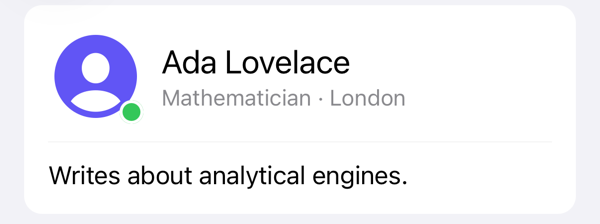

<p align="center">
  <picture>
    <source media="(prefers-color-scheme: dark)" srcset="docs/images/declarative-uikit-dark.svg">
    
  </picture>
</p>

# DeclarativeUIKit

**English** | [简体中文](README.zh-Hans.md) | [繁體中文](README.zh-Hant.md)

Write UIKit layouts the way you would in SwiftUI, and get plain `UIView`s back.

<p align="center">
  <picture>
    <source media="(prefers-color-scheme: dark)" srcset="docs/images/hero-card-dark.png">
    
  </picture>
</p>

```swift
view.addVScroll(alignment: .fill, spacing: 16, safeArea: .all) {
    VStack(alignment: .leading, spacing: 12) {
        HStack(spacing: 12) {
            UIImageView(image: avatar)
                .frame(width: 64, height: 64)
                .overlay(alignment: .bottomTrailing) { statusDot }
            VStack(alignment: .leading, spacing: 2) {
                UILabel()
                    .text("Ada Lovelace")
                    .font(textStyle: .title2)
                UILabel()
                    .text("Mathematician · London")
                    .font(textStyle: .subheadline)
                    .textColor(.secondaryLabel)
            }
            Spacer()
        }
        Divider()
        bio
    }
    .padding(16)
    .background { UIView().background(.secondarySystemGroupedBackground).cornerRadius(12) }
}
.padding(16)
```

## Why DeclarativeUIKit

- **It is still UIKit.** `VStack` is a `UIStackView`, `VScroll` is a `UIScrollView`, and every modifier returns the view you called it on. Mix it with existing code, view controllers and third-party views freely.
- **Layouts read like the screen.** Nesting in the code is nesting on screen, and Auto Layout constraints are written for you.
- **What you write is what you get.** Spacing is 0 unless you set it, nothing is padded unless you pad it, and the safe area applies only where you ask for it.

It is small, has no dependencies, and supports iOS 15 and later.

## Installation

Add the package with Swift Package Manager:

```swift
dependencies: [
    .package(url: "https://github.com/nothingsh/DeclarativeUIKit.git", from: "0.9.0")
]
```

Or in Xcode, choose File → Add Package Dependencies and enter `https://github.com/nothingsh/DeclarativeUIKit`. Requires iOS 15.0+ and Swift 5.9+.

## Quick start

```swift
import DeclarativeUIKit
import UIKit

final class ProfileViewController: UIViewController {
    private let bio = UILabel().font(textStyle: .body).numberOfLines(0)

    override func viewDidLoad() {
        super.viewDidLoad()
        view.background(.systemBackground)

        view.addVStack(alignment: .fill, spacing: 12, safeArea: .all) {
            UILabel().text("Ada Lovelace").font(textStyle: .title2)
            bio
            UIButton(configuration: .filled())
                .title("Show more")
                .onEvent(.primaryActionTriggered) { [weak self] _ in
                    self?.bio.text("Wrote what is often called the first published program.")
                }
            Spacer()
        }
        .padding(16)
    }
}
```

Two things to know from the start:

- **A content closure runs once.** It builds views; it does not re-render them. To change something later, keep the view in a property (like `bio` above) and change it, or bind it with [DeclarativeCombine](#data-binding).
- **Anything without a modifier is still reachable.** `configure { $0.layer.zPosition = 1 }` runs plain UIKit code inside a chain.

## Guide

### Stacks

```swift
VStack(alignment: .leading, spacing: 8) {
    title
    if let subtitle { subtitle }
    for tag in tags { chip(tag) }
    HStack(spacing: 8) {
        icon
        Spacer()          // takes the space that is left
        badge
    }
    Divider()             // a hairline across the stack
    footer
}
```

- `alignment` lines up the elements across the stack: `leading`, `center`, `trailing` or `fill` in a `VStack`; `top`, `center`, `bottom`, the text baselines or `fill` in an `HStack`. `spacing` is 0 by default.
- A content closure accepts views, optionals, arrays, `if`, `switch`, `for` and `if #available`. To swap the elements later, call `replaceContent { … }` on the stack.
- Change a stack afterwards with `.spacing(_:)`, `.spacing(_:after:)`, `.alignment(_:)` and `.distribution(_:)`.

### Size and padding

```swift
VStack { name; role }
    .padding(16)                          // every edge
    .padding(.horizontal, 24)             // only these edges

UIImageView().frame(width: 48, height: 48)
UIButton().frame(minWidth: 88)
UIImageView().frame(width: 320).frame(aspectRatio: 16 / 9)

title.compressionResistancePriority(.defaultLow, for: .horizontal)
```

- `padding` belongs to stacks. To pad a single view, put it in a stack.
- `frame` adds size constraints; calling it again for the same axis replaces the earlier ones.

### Putting views on screen

```swift
view.addContent(page)                          // fills the parent
view.addContent(page, safeArea: .all)          // stays inside the safe area
view.addVStack(spacing: 8, safeArea: .top) {   // builds a stack and adds it
    title
    body
}
```

`addContent`, `addHStack`, `addVStack`, `addHScroll` and `addVScroll` pin the view to all four edges of its parent. Edges you list in `safeArea` stop at the safe area instead, so a background can still reach under the status bar and the home indicator.

### Modifiers

Each common UIKit property has a modifier with the same name, and every modifier returns the view itself, so chains keep their type.

```swift
UILabel()
    .text("Title")
    .font(textStyle: .title2)                                   // follows Dynamic Type
    .numberOfLines(0)

UILabel()
    .font(UIFont(name: "Avenir-Book", size: 16)!, relativeTo: .body)  // custom font, follows Dynamic Type
    .lineHeight(24)
    .kerning(0.2)

UIButton(configuration: .filled())
    .title("Save")
    .image(UIImage(systemName: "checkmark"))
    .cornerStyle(.capsule)

UIView()
    .cornerRadius(12)
    .border(color: .separator, width: 1)                        // follows dark mode
    .shadow(opacity: 0.1, radius: 8)
```

- Use the `text(_:)` modifier rather than assigning `label.text` when a label has a `lineHeight` or `kerning`, and on a `UITextView` with a `placeholder`; a direct assignment skips them.
- The configuration modifiers, such as `cornerStyle` and `baseBackgroundColor`, need a button created with `UIButton(configuration:)`.
- `accessibilityCombined()` makes VoiceOver read a group of labels as one element.

<details>
<summary>All property modifiers</summary>

| Type | Modifiers |
| --- | --- |
| `UIView` and any subclass | `configure`, `alpha`, `isHidden`, `isUserInteractionEnabled`, `contentMode`, `tintColor`, `clipsToBounds`, `background`, `cornerRadius`, `border`, `shadow`, `accessibilityLabel`, `accessibilityHint`, `accessibilityTraits`, `isAccessibilityElement`, `accessibilityIdentifier`, `accessibilityCombined`, `contentHuggingPriority`, `compressionResistancePriority` |
| `UILabel` | `text`, `attributedText`, `font`, `font(textStyle:)`, `font(_:relativeTo:)`, `lineHeight`, `kerning`, `textColor`, `numberOfLines`, `textAlignment`, `lineBreakMode`, `adjustsFontSizeToFitWidth`, `minimumScaleFactor` |
| `UIImageView` | `image`, `highlightedImage`, `preferredSymbolConfiguration` |
| `UIControl` and any subclass | `isEnabled`, `isSelected`, `isHighlighted` |
| `UIButton` | `title`, `titleColor`, `image`, `backgroundImage`, each with an optional `for:` state |
| `UIButton` with a configuration | `buttonSize`, `cornerStyle`, `contentInsets`, `baseForegroundColor`, `baseBackgroundColor`, `subtitle`, `titleAlignment`, `titlePadding`, `titleFont`, `imagePlacement`, `imagePadding`, `preferredSymbolConfigurationForImage`, `showsActivityIndicator` |
| `UISwitch` | `isOn`, `onTintColor` |
| `UISlider` | `value`, `minimumValue`, `maximumValue`, `minimumTrackTintColor`, `maximumTrackTintColor` |
| `UIStepper` | `value`, `minimumValue`, `maximumValue`, `stepValue` |
| `UISegmentedControl` | `selectedSegmentIndex`, `selectedSegmentTintColor`, `isMomentary` |
| `UIPageControl` | `numberOfPages`, `currentPage`, `hidesForSinglePage`, `pageIndicatorTintColor`, `currentPageIndicatorTintColor` |
| `UIProgressView` | `progress`, `progressTintColor`, `trackTintColor` |
| `UIActivityIndicatorView` | `isAnimating`, `hidesWhenStopped`, `color` |
| `UITextField` | `text`, `attributedText`, `placeholder`, `attributedPlaceholder`, `font`, `textColor`, `textAlignment`, `borderStyle`, `clearButtonMode`, `keyboardType`, `returnKeyType`, `isSecureTextEntry`, `autocapitalizationType`, `autocorrectionType`, `textContentType` |
| `UITextView` | `text`, `attributedText`, `placeholder`, `attributedPlaceholder`, `font`, `textColor`, `textAlignment`, `textContainerInset`, `keyboardType`, `returnKeyType`, `isSecureTextEntry`, `autocapitalizationType`, `autocorrectionType`, `textContentType`, `isEditable`, `isSelectable`, `isScrollEnabled` |
| `UIScrollView` and any subclass | `bounces`, `alwaysBounceHorizontal`, `alwaysBounceVertical`, `isPagingEnabled`, `keyboardDismissMode`, `contentInsetAdjustmentBehavior`, `avoidsKeyboard`, `onRefresh` |

</details>

### Events

```swift
UIButton(configuration: .filled())
    .title("Save")
    .onEvent(.primaryActionTriggered) { [weak self] _ in self?.save() }

UISwitch()
    .onEvent(.valueChanged) { [weak self] toggle in self?.settings.isOn = toggle.isOn }

UIImageView(image: avatar)
    .onTapGesture { [weak self] in self?.showProfile() }
    .onLongPressGesture { [weak self] in self?.showMenu() }
```

- The closure receives the control with its own type, so it can read `isOn` or `text` directly.
- `onTapGesture` and `onLongPressGesture` work on any view, including labels and images.
- Views keep their closures: capture a view controller with `[weak self]`.

### Backgrounds and overlays

```swift
UILabel().text("New").background(.systemYellow)              // a background color

VStack { content }
    .padding(16)
    .background { GradientView([.systemTeal, .systemBlue]) }   // a view behind a stack

UIImageView(image: avatar)
    .overlay(alignment: .bottomTrailing, offset: CGPoint(x: 4, y: 4)) { statusDot }
```

There is no `ZStack`: `background { }` puts a view behind a stack, and `overlay { }` puts one in front of any view, at an `alignment` such as `.topTrailing` (`.fill` by default). The decorated view keeps its own size.

### Scroll views

```swift
view.addVScroll(alignment: .fill, spacing: 12, safeArea: .all) {
    header
    HScroll(spacing: 8, showsIndicators: false) {
        for tag in tags { chip(tag) }
    }
    article
}
.padding(16)
.onRefresh { [weak self] in await self?.reload() }
```

- `VScroll` and `HScroll` scroll their elements, which decide how far they scroll. They are not lazy; for long or data-driven content, use [`VList`](#lists).
- `fillsViewport(true)` makes short content fill the screen, so a `Spacer()` can push a button to the bottom.
- To let content scroll under a translucent navigation bar, use `safeArea: .horizontal` and `.contentInsetAdjustmentBehavior(.automatic)`.

### Forms and the keyboard

```swift
let email = UITextField()
    .placeholder("Email")
    .borderStyle(.roundedRect)
    .keyboardType(.emailAddress)
    .textContentType(.emailAddress)
    .returnKeyType(.next)
    .onEvent(.editingDidEndOnExit) { _ in password.becomeFirstResponder() }   // return moves on

let notes = UITextView()
    .placeholder("Anything we should know?")
    .isScrollEnabled(false)                                                   // grows with its text

view.addVScroll(alignment: .fill, spacing: 12, safeArea: .all) {
    email
    password
    notes
}
.avoidsKeyboard(true)
```

`avoidsKeyboard(true)` makes room for the keyboard and scrolls the field being edited into view. It works on any scroll view, including `VList`. Views outside a scroll view do not move.

### Lists

`VList` is a list that creates rows as they come into view and animates changes when you pass new data. It is a `UICollectionView` underneath.

```swift
let list = VList(orders, id: \.id) { [weak self] order in
    ListRow(text: order.title, secondaryText: order.date, image: UIImage(systemName: "bag"))
        .accessories([.disclosureIndicator()])
        .onSelect { self?.show(order) }
        .trailingSwipeActions([
            UIContextualAction(style: .destructive, title: "Delete") { _, _, done in
                self?.delete(order)
                done(true)
            }
        ])
}
.emptyView(UILabel().text("No orders").textColor(.secondaryLabel))
.onReachEnd { [weak self] in self?.loadNextPage() }

view.addContent(list, safeArea: .all)
list.update(newOrders)           // inserts, removes and moves rows by id
```

- Rows come in three kinds: `ListRow(text:secondaryText:image:)` and `ListRow(content:)` in UIKit's standard style; `ListRow(MyRowView.self) { $0.update(item) }` for your own view, created once per cell and reused; and `ListRow { … }` for a static view that is rebuilt each time.
- Your own row view is any `UIView` that declares `ListRowView`. Build it in `init` and give it an `update` method.
- For grouped screens, pass `sections:` with `ListSection(id:header:footer:items:)` and an `appearance` such as `.insetGrouped`, and later call `update(sections:)`.
- `scrollTo(id)` scrolls to a row, and `onRefresh` adds pull to refresh.
- The list sets its own `delegate`, which `onSelect` and `onReachEnd` rely on; do not replace it.

## Example app

`Example/Example.xcodeproj` is a small app with four screens built with the library. Open it, choose the `Example` scheme and an iOS Simulator, and run.

<table>
<tr>
<td align="center"><br><a href="Example/Example/ProfileExampleViewController.swift">Profile card</a></td>
<td align="center"><br><a href="Example/Example/FormExampleViewController.swift">Form</a></td>
<td align="center"><br><a href="Example/Example/ScrollExampleViewController.swift">Scrolling</a></td>
<td align="center"><br><a href="Example/Example/ListExampleViewController.swift">List</a></td>
</tr>
</table>

## Data binding

The library builds views and leaves state to you. [DeclarativeCombine](https://github.com/nothingsh/DeclarativeCombine), a separate optional package, binds views to Combine publishers where they are declared:

```swift
UILabel()
    .bind(\.text, to: viewModel.$title)

UIButton(type: .system)
    .title("Submit")
    .bind(\.isEnabled, to: viewModel.$canSubmit)
    .sink(\.tapPublisher) { [weak self] in self?.submit() }
```

For AppKit, see the sibling package [DeclarativeAppKit](https://github.com/nothingsh/DeclarativeAppKit).

## More

- **Documentation.** Open the package in Xcode and choose Product → Build Documentation for the full API reference and a guide to building reusable components.
- **Xcode previews.** UIKit views preview with `#Preview`, which needs iOS 17; mark the preview `@available(iOS 17, *)` in a target that supports older versions.
- **Debugging layout.** Every constraint the library creates is named after the modifier or view that made it, such as `DeclarativeUIKit.frame.width` or `DeclarativeUIKit.addContent.top`, so a conflict in the console shows where it came from.

## Versioning

Changes are listed in [CHANGELOG.md](CHANGELOG.md). Versions follow [Semantic Versioning](https://semver.org/). From 1.0, minor versions only add API, a renamed API stays available as deprecated until the next major version, and the minimum iOS version rises only with a major version. Before 1.0, a minor version may change the API, and the changelog shows how to migrate.

## Development

The tests use UIKit, so they run in an iOS Simulator rather than with `swift test`:

```sh
IOS_SIMULATOR_ID=<simulator UDID> scripts/test-ios.sh
```

Find a UDID with `xcrun simctl list devices available`.

## License

[MIT](LICENSE), Copyright (c) 2026 Wynn.
