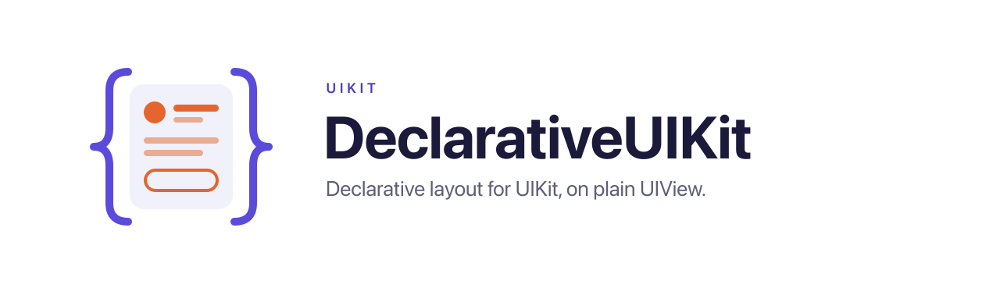
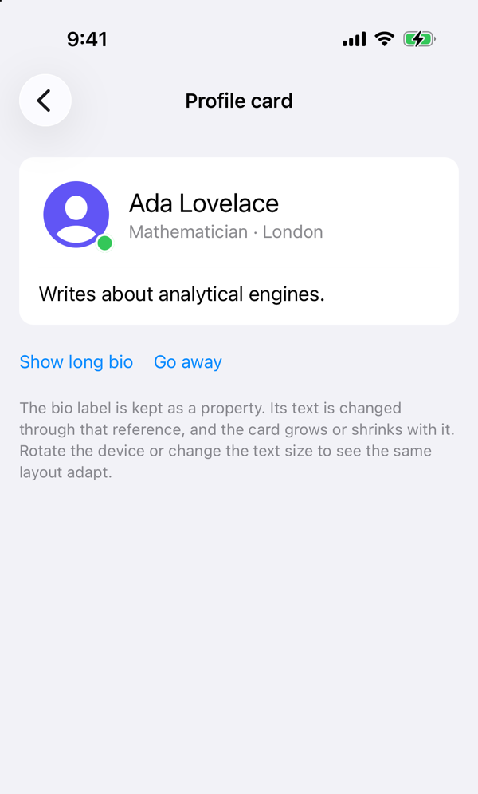
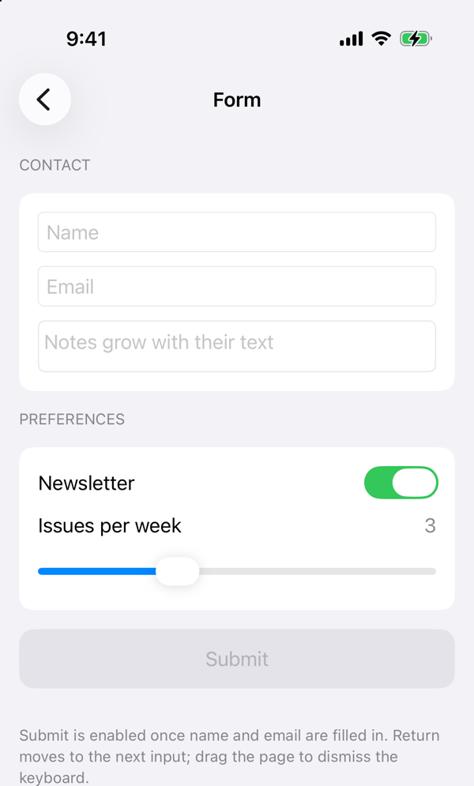
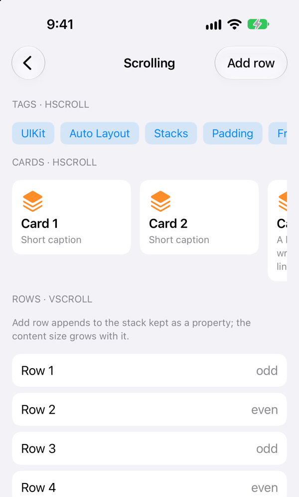
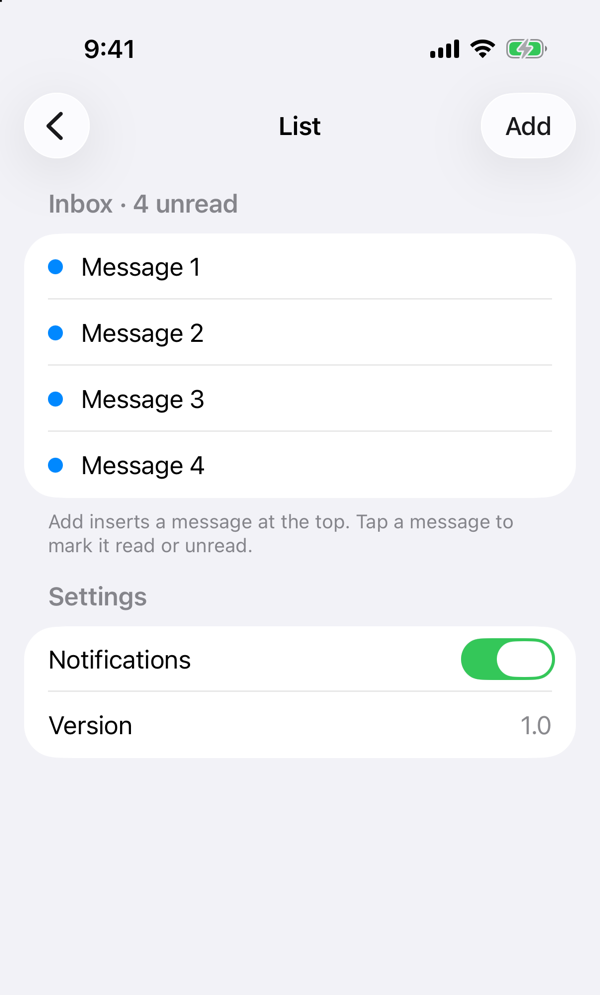

<p align="center">
  <picture>
    <source media="(prefers-color-scheme: dark)" srcset="docs/images/declarative-uikit-dark.svg">
    
  </picture>
</p>

# DeclarativeUIKit

[English](README.md) | [简体中文](README.zh-Hans.md) | **繁體中文**

一個輕量的 UIKit 宣告式版面配置函式庫，以原生 `UIView` 與 Auto Layout 建構，不依賴任何第三方函式庫。

它不引入自訂的繪製層，也不維護平行的視圖階層。你拿到的永遠是真正的 `UIView` 或其子類別，因此能與既有的 UIKit 程式碼自由混用。截圖請見[範例 App](#範例-app)。

資料繫結由搭配的套件 [DeclarativeCombine](https://github.com/nothingsh/DeclarativeCombine) 提供，請見[資料繫結](#資料繫結)。

AppKit 版本請見姊妹套件 [DeclarativeAppKit](https://github.com/nothingsh/DeclarativeAppKit)。

```swift
view.addVStack(alignment: .leading, spacing: 4) {
    UILabel()
        .text("Ada Lovelace")
        .font(textStyle: .headline)
    UILabel()
        .text("Mathematician")
        .font(textStyle: .subheadline)
        .textColor(.secondaryLabel)
}
```

## 目錄

- [安裝](#安裝)
- [用法](#用法)
  - [掛載](#掛載)
  - [Stack](#stack)
  - [屬性 modifier](#屬性-modifier)
  - [事件](#事件)
  - [Padding 與 frame](#padding-與-frame)
  - [Background 與 overlay](#background-與-overlay)
  - [Spacer](#spacer)
  - [捲動視圖](#捲動視圖)
  - [鍵盤](#鍵盤)
  - [清單](#清單)
  - [Xcode 預覽](#xcode-預覽)
  - [除錯版面](#除錯版面)
- [資料繫結](#資料繫結)
- [範例 App](#範例-app)
  - [個人資料卡片](#個人資料卡片)
  - [表單](#表單)
  - [捲動](#捲動)
  - [分組清單](#分組清單)
- [已知限制](#已知限制)
- [開發](#開發)
- [授權條款](#授權條款)

## 安裝

需要 iOS 15.0+ 與 Swift 5.9+。使用 Swift Package Manager 加入：

```swift
dependencies: [
    .package(url: "https://github.com/nothingsh/DeclarativeUIKit.git", from: "0.8.0")
]
```

或在 Xcode 中選擇 File → Add Package Dependencies，輸入 `https://github.com/nothingsh/DeclarativeUIKit`。

各版本的變更請見 [CHANGELOG.md](CHANGELOG.md)。版本號遵循[語意化版本](https://semver.org/lang/zh-TW/)。從 1.0 起，次版本只新增 API；改名的 API 會以已棄用的形式保留到下一個主版本；最低 iOS 版本只在主版本提高。1.0 之前，次版本可能修改 API，變更記錄會說明遷移方式。API 參考文件：在 Xcode 中開啟本 package，選擇 Product → Build Documentation。

## 用法

### 掛載

```swift
view.addContent(page)                          // 填滿父視圖
view.addContent(page, safeArea: .all)          // 保持在安全區域內

view.addVStack(spacing: 8, safeArea: .top) {   // 建構 stack 並掛載
    title
    body
}
```

`addContent` 把視圖的四條邊固定到父視圖，並回傳帶有具體型別的該視圖。`safeArea` 中列出的邊改為固定到父視圖的安全區域。`addHStack`、`addVStack`、`addHScroll` 與 `addVScroll` 把建構與掛載合成一步。

### Stack

```swift
let column = VStack(alignment: .leading, spacing: 4) {
    name
    role
    if isEditing { field }
    for tag in tags { chip(tag) }
    HStack(spacing: 8) {
        icon
        detail
    }
}
```

- `HStack` 與 `VStack` 是 `UIStackView` 的子類別，所有原生 stack API 仍然可用。建構 stack 不會掛載它。
- `alignment` 是交叉軸上的對齊：`VStack` 可用 `leading`、`center`、`trailing` 或 `fill`；`HStack` 可用 `top`、`center`、`bottom`、`firstTextBaseline`、`lastTextBaseline` 或 `fill`。`fill` 會延展每個元素。
- `spacing` 預設為 `0`，因此你看到的間距就是你寫下的間距。之後可以用 `.spacing(_:)`、`.alignment(_:)` 與 `.distribution(_:)` 修改，用 `.spacing(_:after:)` 單獨設定某個元素之後的間距。
- 內容閉包接受視圖、可選視圖、陣列、`if` / `else`、`switch`、`for` 與 `if #available`。
- 內容閉包只執行一次。之後要顯示別的元素，持有這個 stack 並呼叫 `replaceContent { … }`：舊元素會移出視圖階層，background 與 overlay 保留。

### 屬性 modifier

每個 modifier 設定一個 UIKit 屬性，並以 `Self` 回傳該視圖，因此鏈式呼叫保留具體型別。

```swift
let title = UILabel()
    .text("Title")
    .font(textStyle: .title2)                   // 跟隨 Dynamic Type
    .numberOfLines(0)

let body = UILabel()
    .font(UIFont(name: "Avenir-Book", size: 16)!, relativeTo: .body)  // 自訂字型，跟隨 Dynamic Type
    .lineHeight(24)
    .kerning(0.2)
    .numberOfLines(0)
    .text(article.body)

let play = UIButton(type: .system)
    .title("Play")
    .title("Pause", for: .selected)

let save = UIButton(configuration: .filled())
    .title("Save")
    .image(UIImage(systemName: "checkmark"))
    .imagePadding(8)
    .cornerStyle(.capsule)
    .titleFont(textStyle: .headline)            // 跟隨 Dynamic Type

let avatar = UIImageView()
    .image(photo)
    .cornerRadius(24)
    .clipsToBounds(true)
    .configure { $0.layer.zPosition = 1 }       // 沒有對應 modifier 的屬性
```

| 型別 | Modifier |
| --- | --- |
| `UIView` 及其任何子類別 | `configure`、`alpha`、`isHidden`、`isUserInteractionEnabled`、`contentMode`、`tintColor`、`clipsToBounds`、`accessibilityLabel`、`accessibilityHint`、`accessibilityTraits`、`isAccessibilityElement`、`accessibilityIdentifier`、`cornerRadius`、`cornerRadius(_:corners:)`、`border(color:width:)`、`shadow`、`accessibilityCombined` |
| `UILabel` | `text`、`attributedText`、`font`、`font(textStyle:)`、`font(_:relativeTo:)`、`lineHeight`、`kerning`、`textColor`、`numberOfLines`、`textAlignment`、`lineBreakMode`、`adjustsFontSizeToFitWidth`、`minimumScaleFactor` |
| `UIImageView` | `image`、`highlightedImage`、`preferredSymbolConfiguration` |
| `UIControl` 及其任何子類別 | `isEnabled`、`isSelected`、`isHighlighted` |
| `UIButton` | `title`、`titleColor`、`image`、`backgroundImage`，皆帶 `for state: UIControl.State = .normal` |
| 有 configuration 的 `UIButton` | `buttonSize`、`cornerStyle`、`contentInsets`、`baseForegroundColor`、`baseBackgroundColor`、`subtitle`、`titleAlignment`、`titlePadding`、`titleFont`、`titleFont(_:relativeTo:)`、`titleFont(textStyle:)`、`imagePlacement`、`imagePadding`、`preferredSymbolConfigurationForImage`、`showsActivityIndicator` |
| `UISwitch` | `isOn`、`onTintColor` |
| `UISlider` | `value`、`minimumValue`、`maximumValue`、`minimumTrackTintColor`、`maximumTrackTintColor` |
| `UIStepper` | `value`、`minimumValue`、`maximumValue`、`stepValue` |
| `UISegmentedControl` | `selectedSegmentIndex`、`selectedSegmentTintColor`、`isMomentary` |
| `UIPageControl` | `numberOfPages`、`currentPage`、`hidesForSinglePage`、`pageIndicatorTintColor`、`currentPageIndicatorTintColor` |
| `UIProgressView` | `progress(_:animated:)`、`progressTintColor`、`trackTintColor` |
| `UIActivityIndicatorView` | `isAnimating`、`hidesWhenStopped`、`color` |
| `UITextField` | `text`、`attributedText`、`placeholder`、`attributedPlaceholder`、`font`、`font(textStyle:)`、`font(_:relativeTo:)`、`textColor`、`textAlignment`、`borderStyle`、`clearButtonMode`、`keyboardType`、`returnKeyType`、`isSecureTextEntry`、`autocapitalizationType`、`autocorrectionType`、`textContentType` |
| `UITextView` | `text`、`attributedText`、`placeholder`、`attributedPlaceholder`、`font`、`font(textStyle:)`、`font(_:relativeTo:)`、`textColor`、`textAlignment`、`textContainerInset`、`keyboardType`、`returnKeyType`、`isSecureTextEntry`、`autocapitalizationType`、`autocorrectionType`、`textContentType`、`isEditable`、`isSelectable`、`isScrollEnabled` |

`font(textStyle:)` 跟隨 Dynamic Type，`font(_:)` 則設定固定字型。`font(_:relativeTo:)` 讓自訂字型像該文字樣式的系統字型一樣跟隨 Dynamic Type；傳入預設文字大小下應有的字級。按鈕的 modifier 為每個控制項狀態各設定一個值。`value`、`selectedSegmentIndex`、`currentPage` 這類設定值的 modifier 不會傳送 `.valueChanged`。

有 configuration 的按鈕的 modifier 修改它的 `UIButton.Configuration`，所以要用 `UIButton(configuration:)` 建立按鈕；對沒有 configuration 的按鈕呼叫時會以 precondition 失敗終止。`title` 與 `image` 對兩種按鈕都有效，並且依狀態生效。有 configuration 的按鈕請用 `baseForegroundColor` 而不是 `titleColor` 設定文字顏色，用 configuration 的 `background` 而不是 `backgroundImage` 設定背景。`titleFont` 會取代 configuration 的 `titleTextAttributesTransformer`；`relativeTo:` 與 `textStyle:` 兩種形式跟隨 Dynamic Type。

`lineHeight` 設定每行的高度，與設計工具中的行高相同；`kerning` 設定每個字元後的間距。`UILabel` 沒有對應的屬性，所以由 label 保存這兩個值並寫入 `attributedText`。`text`、`attributedText`、`font` modifier 會重新套用它們；直接指派 `label.text = …` 不會，所以更新文字時請用 `label.text(…)`。文字依 UIKit 的方式貼齊每行底部，而不像設計工具那樣垂直置中。行高相對於字型，所以會隨 Dynamic Type 變大。

`UITextView` 本身沒有 placeholder。`placeholder` 與 `attributedPlaceholder` 在文字視圖為空時，於文字起始處顯示一行預留位置文字，顏色預設為 placeholder 顏色，帶屬性的形式則依它自己的屬性。輸入時它會自動隱藏與顯示；`text`、`attributedText`、`font`、`textAlignment`、`textContainerInset` modifier 會同步更新它，直接指派 `textView.text = …` 不會。

`cornerRadius`、`border` 與 `shadow` 設定視圖的 layer。`cornerRadius` 不會裁切：需要時加上 `clipsToBounds(true)`，但它也會裁掉陰影。`corners` 只圓指定的角，以實體方向命名，例如左上角 `.layerMinXMinYCorner`，因此不會隨由右至左的語言鏡像。邊框與陰影顏色會隨淺色、深色模式切換：視圖會多一個隱藏的子視圖，在外觀改變時重新解析顏色。直接指派 `layer.borderColor` 則不會跟隨。

`accessibilityCombined()` 讓 VoiceOver 把一個視圖及其子視圖讀成一個元素，標籤由可見子視圖的標籤依序連接而成，並隨之變化。只合併標籤，所以不要用在含有按鈕等控制項的區域。

### 事件

`onEvent` 在控制項每次傳送指定的 `UIControl.Event` 時執行閉包。閉包收到的是控制項本身，型別不變，因此不必把控制項存成屬性，也能讀取 `isOn`、`value` 或 `text`。`onTapGesture` 與 `onLongPressGesture` 適用於任何視圖。

```swift
UISwitch()
    .onEvent(.valueChanged) { [weak self] toggle in
        self?.settings.isEnabled = toggle.isOn
    }

UIButton(type: .system)
    .title("Save")
    .onEvent(.primaryActionTriggered) { [weak self] _ in self?.save() }

UIImageView(image: avatar)
    .onTapGesture { [weak self] in self?.showProfile() }
    .onLongPressGesture { [weak self] in self?.showMenu() }
```

- 兩個手勢 modifier 各加入一個手勢辨識器，並開啟 `isUserInteractionEnabled`；`UILabel` 與 `UIImageView` 預設是關閉的。`onTapGesture(count:perform:)` 預設點一下。`onLongPressGesture(minimumDuration:perform:)` 在按壓持續 `minimumDuration`（預設 0.5 秒）時執行一次閉包。
- 每次呼叫都會再加入一個 action 或辨識器，先前的仍然保留。要停止回應，以 `isEnabled` 或 `isUserInteractionEnabled` 關閉控制項或視圖。
- 控制項持有它的閉包，視圖持有它的辨識器及其閉包。擷取 view controller 時寫 `[weak self]`，否則它與視圖會互相持有。
- 委派（例如 `UITextFieldDelegate`）照常設定。

### Padding 與 frame

```swift
let card = VStack(alignment: .leading, spacing: 4) {
    name
    role
}
.padding(16)                // 每條邊
.padding(.horizontal, 24)   // 只改指定的邊

stack.padding(horizontal: 16, vertical: 12)
stack.padding(top: 8, leading: 16, bottom: 24, trailing: 12)

let avatar = UIImageView().frame(width: 48, height: 48)
let button = UIButton().frame(minWidth: 88)
let banner = UIImageView().frame(width: 320).frame(aspectRatio: 16 / 9)   // 320 × 180
```

- `padding` 是 stack 的 modifier。它在每條邊上都是固定距離，計入 stack 的尺寸，從不包含安全區域。要給單一視圖加上 padding，把它放進 stack。
- `frame` 給任意視圖加上 required 的尺寸約束。對同一條軸的後一次呼叫會取代前一次。

### Background 與 overlay

```swift
let badge = UILabel().text("New").background(.systemYellow)          // 視圖本身的背景色

let card = VStack { name }
    .padding(16)
    .background { UIView().background(.secondarySystemBackground) }  // stack 後方的任意視圖

// 在視圖前方，並從角上向外偏移
let avatar = UIImageView()
    .frame(width: 48, height: 48)
    .overlay(alignment: .bottomTrailing, offset: CGPoint(x: 4, y: 4)) { statusDot }
```

- `background(_:)` 設定視圖本身的 `backgroundColor`，stack 也會繪製它。`background { ... }` 則是在 stack 後面放一個完整的視圖。
- `GradientView([.systemTeal, .systemBlue])` 繪製線性漸層，預設由上到下；搭配 `background { … }` 使用。點使用單位座標，與 `CAGradientLayer` 相同，顏色隨深色模式變化。
- 視圖形式的裝飾是以約束固定的子視圖；不會插入容器視圖，也沒有 `ZStack`。`alignment` 預設為 `.fill`，也可以是 `.topTrailing` 這樣的位置。
- 被裝飾視圖本身的內容決定其尺寸。
- `offset` 把裝飾從 `alignment` 決定的位置移開：x 正值朝右，y 正值朝下。這個值原樣交給 Auto Layout：在由右至左的版面中，leading 或 trailing 對齊的水平方向會反過來，置中的對齊則不會；如果不希望這樣，請自行調整傳入的值。`.fill` 不接受 offset。

### Spacer

```swift
let header = HStack {
    title.compressionResistancePriority(.defaultLow, for: .horizontal)
    Spacer(minLength: 8)
    badge
}
```

`Spacer` 沿所在 stack 的軸佔據剩餘長度，多個 spacer 平分它。`contentHuggingPriority(_:for:)` 與 `compressionResistancePriority(_:for:)` 決定其他視圖中哪一個先變大或先縮小。

`Divider()` 是橫跨所在 stack 的細線：在 `VStack` 中為橫線，在 `HStack` 中為直線。無論對齊方式為何，它都在 padding 之內鋪滿 stack，顏色為 `.separator`，可用 `background(_:)` 修改。

```swift
VStack(alignment: .leading, spacing: 12) {
    header
    Divider()
    body
}
.padding(16)
```

### 捲動視圖

```swift
view.addVScroll(alignment: .fill, spacing: 12) {
    title
    HScroll(spacing: 8, showsIndicators: false) {
        for name in tagNames { chip(name) }
    }
    body
}
.padding(16)
```

- `HScroll` 與 `VScroll` 是 `UIScrollView` 的子類別，以內建的 stack 排列元素，可透過 `stack` 存取。元素決定 content size；在另一條軸上，內容與捲動視圖一致。
- 巢狀放在 stack 中時，`HScroll` 的高度由元素決定，但寬度需要由外部給定，`VScroll` 則相反：像上面那樣使用 `.fill` 對齊，或使用 `frame`。
- `alignment`、`spacing`、`spacing(_:after:)`、`replaceContent` 以及各種形式的 `padding` 都會轉發給 `stack`；padding 位於捲動內容之內。
- `contentInsetAdjustmentBehavior` 為 `.never`，因此內容從捲動視圖的邊緣開始。以 `safeArea` 掛載捲動視圖即可讓它保持在安全區域內。
- `isPagingEnabled` 與 `keyboardDismissMode` 設定對應的屬性。`onRefresh { await … }` 加入下拉更新：更新控制項會持續轉動，直到閉包返回。再次呼叫會取代先前的動作。
- 內容較短時保持自身長度，因此沿捲動方向的 `Spacer` 沒有空間可佔。`fillsViewport(true)` 讓內容至少與 `VScroll` 一樣高，或與 `HScroll` 一樣寬；多出的長度由 `Spacer` 佔據，可以把按鈕留在短表單的底部，內容更長時照常捲動：

```swift
view.addVScroll(alignment: .fill, spacing: 12, safeArea: .all) {
    form
    Spacer()
    submit
}
.fillsViewport(true)
```

- 要讓內容捲到半透明導覽列下方，只在左右兩側把捲動視圖約束到安全區域，由 UIKit 依導覽列等設定內容的 inset。內容從導覽列下方開始，捲到導覽列下方時導覽列會顯示背景。`fillsViewport` 與 `avoidsKeyboard` 會考慮這些 inset：

```swift
view.addVScroll(alignment: .fill, spacing: 12, safeArea: .horizontal) {
    form
}
.contentInsetAdjustmentBehavior(.automatic)
```

### 鍵盤

```swift
let email = UITextField()
    .placeholder("Email")
    .textContentType(.emailAddress)
    .returnKeyType(.next)
    .onEvent(.editingDidEndOnExit) { _ in password.becomeFirstResponder() }  // 按 return 跳到下一個輸入欄位

view.addVScroll(alignment: .fill, spacing: 12, safeArea: .all) {
    email
    password
    notes
}
.avoidsKeyboard(true)
```

- `avoidsKeyboard(true)` 適用於任何 `UIScrollView`，包括 `VScroll`、`VList` 與可捲動的 `UITextView`。鍵盤遮住捲動視圖的一部分時，被遮住的高度會加到底部的 content inset 與捲動指示器 inset，正在編輯的輸入欄位會捲到鍵盤上方。你自己設定的 inset 會保留。預設關閉。
- 只計算被遮住的部分：底邊在鍵盤上方的捲動視圖不變，iPad 上的浮動鍵盤不算遮擋。
- 捲動視圖之外的視圖不會移動。必須能點到的按鈕請放在捲動視圖內容的末端。
- 按下 return 時文字欄位會傳送 `.editingDidEndOnExit`，所以用 `onEvent` 就能跳到下一個輸入欄位，不需要委派。

### 清單

`VList` 是垂直清單：列在捲動進入畫面時才建立，資料更新時依差異重新整理。它是使用 UIKit 清單版面配置與 diffable data source 的 `UICollectionView`，函式庫只增加了列的宣告方式。

```swift
final class OrderRow: UIView, ListRowView {
    private let title = UILabel().font(textStyle: .headline)
    private let price = UILabel().font(textStyle: .body)

    override init(frame: CGRect) {
        super.init(frame: frame)
        addHStack(spacing: 12) {
            title
            Spacer()
            price
        }
        .padding(horizontal: 16, vertical: 12)
    }

    required init?(coder: NSCoder) { fatalError() }

    func update(_ order: Order) {
        title.text(order.title)
        price.text(order.price)
    }
}

let orders = view.addContent(VList<Order>(id: \.id) { [weak self] order in
    ListRow(OrderRow.self) { $0.update(order) }
        .accessories([.disclosureIndicator()])
        .onSelect { self?.show(order) }
}, safeArea: .all)

orders.update(firstPage)
orders.update(firstPage + secondPage)
```

- `update` 依 `id` 插入、刪除、移動列，預設帶動畫。新舊資料中都有的 id 所對應的列都會重新設定，所以 `Item` 不需要遵循 `Equatable`。id 在整個清單內必須唯一。
- `ListRow(OrderRow.self) { … }` 是可重複使用的列。清單以 `init()` 建立 view，每個 cell 一次；每當這一列顯示或其 item 變更時呼叫閉包，閉包裡只做指定。view 建立時拿不到 item，所以不會有某一項的資料殘留在被重複使用於其他項的 view 上。
- `ListRow { … }` 每次都重建 view，適合靜態的列，例如 App 版本號。帶控制項或頻繁更新的列應使用可重複使用的列，因為重建會遺失控制項狀態。
- `accessories` 接受 UIKit 的 `UICellAccessory`。只有設定了 `onSelect` 的列會醒目提示；閉包執行後該列立即取消選取。
- 列的內容填滿 cell，由 Auto Layout 決定高度。清單本身不加內距，padding 由每一列自行設定。
- 分組畫面傳入 `sections:` 與 `appearance`，例如 `.insetGrouped`。`ListSection` 接受 `id` 以及選用的 `header`、`footer` 文字，使用 UIKit 的預設樣式。

```swift
let settings = VList(
    sections: [
        ListSection(id: "general", header: "General", items: [Setting.account, .notifications]),
        ListSection(id: "about", items: [Setting.version])
    ],
    id: \.self,
    appearance: .insetGrouped
) { setting in
    ListRow { SettingRow(setting) }
}
```

- `listConfiguration` 調整每個 section 的 `UICollectionLayoutListConfiguration`。分隔線的起點由系統決定，隨 iOS 版本與機型而異；要與列的 padding 對齊，請在這裡設定 `separatorConfiguration`。
- 與捲動視圖一樣，`VList` 的 `contentInsetAdjustmentBehavior` 為 `.never`；以 `safeArea` 掛載它。
- 清單自己擔任 `delegate` 來處理選取。替換 delegate 會讓 `onSelect` 失效。
- 清單持有 row 閉包，每個 cell 持有自己的 `onSelect` 閉包。捕獲 view controller 時請寫 `[weak self]`，否則它與清單會互相持有。
- 搭配 [DeclarativeCombine](#資料繫結) 時，以 `onReceive` 將 publisher 接到 `update`：`list.onReceive(viewModel.$orders) { $0.update($1) }`。

標準樣式的列、滑動動作、載入更多與空狀態：

```swift
let list = VList(orders, id: \.id) { [weak self] order in
    ListRow(text: order.title, secondaryText: order.date, image: UIImage(systemName: "bag"))
        .trailingSwipeActions([
            UIContextualAction(style: .destructive, title: "Delete") { _, _, done in
                self?.delete(order)
                done(true)
            }
        ])
}
.emptyView(UILabel().text("No orders").textColor(.secondaryLabel))
.onReachEnd { [weak self] in self?.loadNextPage() }
.onRefresh { [weak self] in await self?.reload() }

list.scrollTo(order.id)
```

- `ListRow(text:secondaryText:image:)` 是 UIKit 標準樣式的列，由 cell 依清單外觀的預設 content configuration 排版，分隔線與文字對齊。`ListRow(content:)` 接受任意 `UIListContentConfiguration`，例如兩側都有文字的 `.valueCell()`。
- `leadingSwipeActions` 與 `trailingSwipeActions` 接受 UIKit 的 `UIContextualAction`，每個 handler 都必須呼叫它的 completion handler。`allowsFullSwipe` 預設開啟，完整滑動會執行第一個動作。`listConfiguration` 無法修改滑動動作。
- `onReachEnd` 在最後一列即將顯示時執行。更新後出現的新最後一列，以及捲回畫面的最後一列都會觸發，所以載入中請忽略這些呼叫。
- `scrollTo` 依 id 捲動到某一列，預設只捲到剛好可見，也可以傳入 `.top` 等位置。id 必須在清單中。
- `emptyView` 在清單沒有任何列時顯示於清單中央，即使有 section 標題也是如此。`offset` 讓它偏離中央，x 向右為正、y 向下為正，與 `overlay` 相同。它保存在 `backgroundView` 中。
- `onRefresh` 適用於任何捲動視圖，見[捲動視圖](#捲動視圖)。

### Xcode 預覽

Xcode 15 以上版本可以直接預覽 UIKit 視圖。UIKit 的 `#Preview` 巨集需要 iOS 17，因此在支援更低版本的 target 中，要為預覽加上 `@available(iOS 17, *)`。只有預覽需要 iOS 17，其餘程式碼的部署目標不變。

```swift
@available(iOS 17, *)
#Preview {
    VStack(alignment: .leading, spacing: 4) {
        UILabel().text("Ada Lovelace").font(textStyle: .headline)
        UILabel().text("Mathematician").textColor(.secondaryLabel)
    }
    .padding(16)
}
```

### 除錯版面

函式庫建立的每一條約束都以 `DeclarativeUIKit.` 加上建立它的 modifier 命名，例如 `addContent.top`、`frame.width`、`overlay.centerY`、`spacer.minLength` 或 `fillsViewport`。約束衝突時，主控台會顯示這些名稱，由此可以知道該修改哪個 modifier：

```text
Unable to simultaneously satisfy constraints.
    <NSLayoutConstraint:0x600002b0c3c0 'DeclarativeUIKit.frame.width' UIView:0x10310a2c0.width == 40   (active)>
    <NSLayoutConstraint:0x600002b0c460 'DeclarativeUIKit.addContent.leading' H:|-(0)-[UIView:0x10310a2c0]   (active, names: '|':UIView:0x10310a100 )>
```

UIKit 本身的工具照常可用：Xcode 的 View Debugger 顯示視圖階層與每個視圖的約束，`hasAmbiguousLayout` 與 `exerciseAmbiguityInLayout()` 可以找出尺寸或位置沒有完全確定的視圖。

## 資料繫結

DeclarativeUIKit 只負責版面配置：內容閉包只執行一次，函式庫本身不提供繫結。之後需要變化的視圖，必須存成屬性，再手動更新。

[DeclarativeCombine](https://github.com/nothingsh/DeclarativeCombine) 是搭配的套件，用來省掉這一步。它為 UIKit 的控制項、捲動視圖和手勢提供 Combine publisher，並提供一組 modifier，讓視圖在宣告它的地方直接繫結到 publisher：

```swift
view.addVStack(alignment: .fill, spacing: 12) {
    UILabel()
        .font(textStyle: .body)
        .bind(\.text, to: viewModel.$title)

    UIButton(type: .system)
        .title("Submit")
        .bind(\.isEnabled, to: viewModel.$canSubmit)
        .sink(\.tapPublisher) { [weak self] in self?.submit() }
}
```

它是選用的、獨立的套件。DeclarativeUIKit 不依賴它，它也不依賴 DeclarativeUIKit；兩個套件一起加入即可搭配使用。它的範例 App 把下面的[表單](#表單)畫面重寫了一遍，一個視圖都沒有存成屬性。

## 範例 App

`Example/Example.xcodeproj` 是一個以本機 package 方式使用本函式庫的小型 iOS App。在 Xcode 中開啟它，選擇 `Example` scheme 與一個 iOS 模擬器，然後執行。以下的程式碼片段節錄自它的四個畫面。

### 個人資料卡片

程式碼的結構與畫面的結構一致。狀態徽章透過 `overlay` 附加到大頭貼上，不需要包裝視圖，也不需要 `ZStack`。`bio` 與 `status` 都是一般屬性：按鈕直接修改它們，Auto Layout 會調整卡片的大小。不會重建任何視圖。`Divider` 分隔標頭與簡介，`accessibilityCombined` 讓 VoiceOver 把姓名與職業讀成一個元素。

<table>
<tr>
<td>

```swift
VStack(alignment: .leading, spacing: 12) {
    HStack(spacing: 12) {
        UIImageView()
            .image(UIImage(systemName: "person.crop.circle.fill"))
            .tintColor(.systemIndigo)
            .frame(width: 64, height: 64)
            .overlay(alignment: .bottomTrailing) { status }
        VStack(alignment: .leading, spacing: 2) {
            UILabel()
                .text("Ada Lovelace")
                .font(textStyle: .title2)
            UILabel()
                .text("Mathematician · London")
                .font(textStyle: .subheadline)
                .textColor(.secondaryLabel)
        }
        Spacer()
    }
    .accessibilityCombined()
    Divider()
    bio
}
.card()

// 之後，在按鈕的 action 中：
bio.text(Self.longBio)
status.background(.systemGray)
```

</td>
<td width="300">

</td>
</tr>
</table>

可重複使用的樣式只是一個以 modifier 組成的函式。`card()` 是範例 App 自己的輔助方法，不屬於本函式庫：

```swift
extension UIStackView {
    func card(padding: CGFloat = 16) -> Self {
        self.padding(padding)
            .background {
                UIView()
                    .background(.secondarySystemGroupedBackground)
                    .cornerRadius(12)
            }
    }
}
```

### 表單

控制項就是一般的 `UITextField`、`UISwitch` 與 `UISlider`，以 modifier 設定並作為屬性持有。事件以 `onEvent` 閉包處理，return 鍵跳到下一個輸入欄位。頁面以 `avoidsKeyboard` 為鍵盤留出空間，備註視圖顯示 placeholder。`Spacer` 把開關與數值推到尾端邊緣。

<table>
<tr>
<td>

```swift
private let newsletter = UISwitch().isOn(true)

private let frequency = UISlider()
    .minimumValue(1)
    .maximumValue(7)
    .value(3)

// 在 viewDidLoad 中：
frequency.onEvent(.valueChanged) { [weak self] _ in
    self?.frequencyChanged()
}

VStack(alignment: .fill, spacing: 12) {
    HStack(spacing: 8) {
        UILabel()
            .text("Newsletter")
            .font(textStyle: .body)
        Spacer()
        newsletter
    }
    HStack(spacing: 8) {
        UILabel()
            .text("Issues per week")
            .font(textStyle: .body)
        Spacer()
        frequencyValue
    }
    frequency
}
.card()
```

</td>
<td width="300">

</td>
</tr>
</table>

### 捲動

`VScroll` 中巢狀放入 `HScroll` 列。內容閉包支援 `for` 迴圈，回傳 `UIView` 的小函式可以像其他視圖一樣組合。點一下 *Add row* 會向作為屬性持有的 stack 追加一列，捲動視圖的 content size 隨之更新。

<table>
<tr>
<td>

```swift
HScroll(spacing: 8, showsIndicators: false) {
    for tag in Self.tags { chip(tag) }
}

HScroll(alignment: .top, spacing: 12) {
    for index in 1...8 { card(index) }
}

rows

private func chip(_ text: String) -> UIView {
    VStack {
        UILabel()
            .text(text)
            .font(textStyle: .subheadline)
            .textColor(.systemBlue)
    }
    .padding(horizontal: 12, vertical: 6)
    .background {
        UIView()
            .background(UIColor.systemBlue.withAlphaComponent(0.12))
            .configure { $0.layer.cornerRadius = 8 }
    }
}
```

</td>
<td width="300">

</td>
</tr>
</table>

### 分組清單

帶標題與註腳的 `.insetGrouped` `VList`。`MessageRow` 與 `SwitchRow` 是可重複使用的列；儲存空間一列是標準列，版本號一列每次重建。點 *Add*、點選訊息、滑動刪除與下拉更新都會修改資料並呼叫 `update`：新列帶動畫插入，變更的列與標題中的未讀數隨之更新。

<table>
<tr>
<td>

```swift
VList(sections: sections(), id: \.id, appearance: .insetGrouped) { [weak self] row in
    switch row {
    case .message(let message):
        return ListRow(MessageRow.self) { $0.update(message) }
            .onSelect { self?.toggleRead(message.id) }
            .trailingSwipeActions([
                UIContextualAction(style: .destructive, title: "Delete") { _, _, done in
                    self?.deleteMessage(message.id)
                    done(true)
                }
            ])
    case .notifications:
        return ListRow(SwitchRow.self) {
            $0.update(title: "Notifications", isOn: self?.notifications ?? false)
            $0.onChange = { self?.notifications = $0 }
        }
    case .storage:
        var content = UIListContentConfiguration.valueCell()
        content.text = "Storage"
        content.secondaryText = "1.2 GB"
        content.image = UIImage(systemName: "internaldrive")
        return ListRow(content: content)
    case .version:
        return ListRow {
            HStack(spacing: 8) {
                UILabel().text("Version").font(textStyle: .body)
                Spacer()
                UILabel().text("1.0").font(textStyle: .body).textColor(.secondaryLabel)
            }
            .padding(horizontal: 16, vertical: 12)
        }
    }
}

private func toggleRead(_ id: Int) {
    guard let index = messages.firstIndex(where: { $0.id == id }) else { return }
    messages[index].isRead.toggle()
    list.update(sections: sections())
}
```

</td>
<td width="300">

</td>
</tr>
</table>

所有文字都使用 `font(textStyle:)`，因此各畫面會跟隨動態字體，並能適應旋轉。內容閉包只執行一次；之後的變化透過視圖本身完成，而不是透過資料繫結。

每個畫面只在左右兩側把捲動視圖約束到安全區域，由 UIKit 依導覽列與主畫面指示條設定內容的 inset。內容從導覽列下方開始並能捲到它下方，橫向時避開感測器區域，畫面的背景顏色仍然鋪滿整個螢幕。

範例 App 的部署目標是 iOS 15.0，與本 package 相同。

## 已知限制

`VScroll` 與 `HScroll` 不是惰性的：所有元素都會預先建立並配置版面。它們適合頁面與較短的清單；較長或由資料驅動的清單請使用 [`VList`](#清單)。

## 開發

測試會呼叫 UIKit，必須在 iOS 模擬器中執行；在 macOS 上執行 `swift test` 不是有效的測試方式。

```sh
IOS_SIMULATOR_ID=<simulator UDID> scripts/test-ios.sh
```

使用 `xcrun simctl list devices available` 查詢 UDID。

## 授權條款

[MIT](LICENSE)，Copyright (c) 2026 Wynn.
